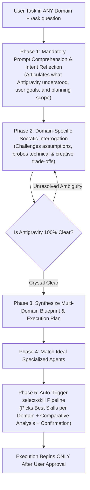

# Ask Question — Universal Multi-Domain Socratic Interrogation & Planning Engine

`ask-question` is an ultra-sensitive requirements architect and project interrogation engine. It operates across **every single technical, creative, and engineering domain** supported by Antigravity's 5,076+ skills library.

## ⚡ Ultra-High Sensitivity Triggering
If the user's prompt contains **ANY** keyword, command, or conversational phrase related to asking questions, clarifying requirements, or interrogating a project idea (e.g., `ask question`, `ask questions`, `interrogate`, `clarify requirements`, `challenge my idea`, `interview me`, `ask me`), the agent **MUST IMMEDIATELY trigger this skill without hesitation**.

Crucially, **the very first step of `ask-question` is to state in full detail what Antigravity understood from the user's prompt, what the user is asking Antigravity to do, and the internal planning recognized before presenting Socratic questions.**

---

## The 5-Phase Operational Workflow



---

### Phase 1: Mandatory Prompt Comprehension & Intent Reflection (FIRST STEP)
Before asking any questions or proposing solutions, Antigravity MUST immediately communicate a comprehensive breakdown of what it grasped from the user's input:
- **🧠 What Antigravity Understood From Your Prompt:** Complete, deep interpretation of the user's idea, concept, technical/creative requirements, context, and implied constraints.
- **🎯 What You Want From Antigravity (User Goal & Expectations):** Clear articulation of the exact deliverables, outcome, and goals the user expects Antigravity to accomplish.
- **🗺️ Recognized Planning & Architectural Scope:** The high-level vision, identified complexity dimensions, and strategic execution direction Antigravity intends to explore.

### Phase 2: Domain-Adaptive Socratic Interrogation
Following the comprehension reflection, the agent evaluates the domain(s) of the user's idea and asks 3–5 sharp, high-impact questions specifically relevant to that field. It probes for:
1. Performance, precision, and fidelity constraints.
2. Tooling, runtime, and framework boundaries.
3. Edge cases, failure modes, and safety standards.
4. Output format and delivery criteria.

### Phase 3: Comprehensive Project Blueprint
Once questions are answered and 100% clarity is achieved, synthesizes all gathered requirements into a crystal-clear, structured technical specification and phased roadmap.

### Phase 4: Match Specialized Agents
Assigns specialized agent personas suited to the task (e.g. `Embedded Firmware Engineer`, `DevOps Automator`, `Technical Artist`, `Audio Production Engineer`, `Senior Architect`).

### Phase 5: Automatic Handoff to `select-skill`
Automatically initiates `select-skill` across all identified domains:
- Runs Step 1: Prompt Comprehension & Intent Reflection.
- Selects the **#1 Best Skill** for each domain with a description and competitive comparison.
- Lists the available **Alternative Candidate Skills**.
- **Pauses and asks for user confirmation** before taking any action.

---

## Output Template for Phase 1 & Phase 2

When `ask-question` is invoked, the output MUST be formatted as follows:

```markdown
### 🧠 Step 1: Antigravity Prompt Comprehension & Intent Reflection
- **What Antigravity Understood From Your Prompt:** [Full, detailed description of your idea, scope, and technical context as interpreted by Antigravity]
- **What You Want From Antigravity:** [Clear statement of your exact goals, deliverables, and expectations]
- **Recognized Planning & Strategy Scope:** [Initial high-level architectural roadmap and planning direction identified by Antigravity]

---

### ❓ Step 2: Socratic Architectural Interrogation
To ensure 100% architectural precision before we write code or select skills, please answer or confirm the following critical questions:

1. **[Domain / Technical Angle 1]:** [Specific probing question on architecture, trade-off, or performance]
2. **[Domain / Technical Angle 2]:** [Specific probing question on data model, protocol, or runtime]
3. **[Domain / Technical Angle 3]:** [Specific probing question on edge cases, safety, or failure handling]
4. **[Domain / Technical Angle 4]:** [Specific probing question on UI/UX, output format, or integration]
```
