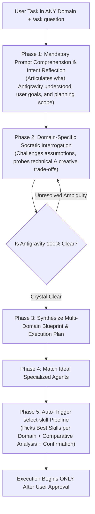

# Ask Question — Universal Multi-Domain Socratic Interrogation & Planning Engine

`ask-question` is a universal requirements architect and project interrogation engine. It operates across **every single technical, creative, and engineering domain** supported by Antigravity's 5,076+ skills library.

It never limits its questioning to generic web apps or UI/UX. Whether your task involves **embedded firmware, 3D CAD modeling, cinematic video editing, audio mastering, Kubernetes clustering, smart contract security, AI fine-tuning, game physics, or bioinformatics**, `ask-question` dynamically adapts its interrogation to that specific domain's deepest technical challenges, clarifies every ambiguity, builds a structured execution blueprint, and automatically chains into `select-skill`.

Crucially, **the very first step of `ask-question` is to state in full detail what Antigravity understood from the user's prompt, what the user is asking Antigravity to do, and the internal planning recognized before presenting Socratic questions.**

---

## Universal Domain Interrogation Matrix (All Domains Supported)

When presented with an idea in ANY field, `ask-question` dynamically selects the appropriate interrogation angles:

### 1. 3D Modeling, Computer Graphics & Web 3D
- Mesh topology, polygon budgets, Level of Detail (LOD), UV unwrapping, and texture map formats (PBR, normal, roughness, metallic).
- Target engine/runtime: Blender Python script, Three.js, React Three Fiber, Spline, or WebGPU/WebGL canvas.
- Lighting environment, shader complexity (GLSL/TSL), physics colliders, and export format targets (GLTF, GLB, USDZ, OBJ, FBX).

### 2. Video Editing, VFX & Post-Production
- Target aspect ratio, framerate (24fps, 30fps, 60fps), and resolution (1080p, 4K, vertical 9:16 vs cinematic 16:9).
- Tooling workflow: FFmpeg programmatic scripting, Remotion React code-based video, HyperFrames, or DaVinci/Premiere XML timelines.
- Color grading LUTs, motion transitions (whip pans, zoom blurs, match cuts), typography pacing, audio syncing, and export codecs (H.264, ProRes).

### 3. Audio Engineering, Sound Design & Voice
- Audio fidelity, sample rate (44.1kHz vs 48kHz), bitrate, dynamic range, and loudness normalization standards (-14 LUFS, EBU R128).
- Stem processing: vocal isolation, noise suppression, EQ curve, dynamic compression, spatial audio/panning.
- Synthesis targets: Voice cloning, TTS narration, Foley sound effects, or procedural music generation.

### 4. Photo Editing, Computer Vision & Image Synthesis
- Target color space (sRGB, Adobe RGB, Display P3), bit depth, and compression ratios.
- Manipulation pipeline: OpenCV transformations, PIL/Pillow batching, ImageMagick color profiles, or AI inpainting/outpainting.
- Layer compositing, subject isolation masks, retouching parameters, and resolution scaling.

### 5. Cybersecurity, Red-Teaming & Vulnerability Assessment
- Threat model scope: external network surface, API authentication vectors, OWASP Top 10, or cloud IAM privilege escalation.
- Auth mechanisms under test: OAuth2 flows, JWT cryptographic signatures, SAML assertions, session cookies, or CORS policies.
- Compliance & safety boundaries: Passive analysis vs active fuzzing, penetration testing boundaries, and disclosure reporting standards.

### 6. DevOps, Cloud Infrastructure & Systems Engineering
- Cloud provider & deployment topology: AWS, Azure, GCP, or bare-metal Linux.
- Containerization & orchestration: Dockerfile hardening, multi-stage builds, Kubernetes Helm charts, ingress controllers, or service meshes (Istio/Linkerd).
- Infrastructure as Code (IaC): Terraform state configuration, environment secrets management (Vault/SOPS), and CI/CD pipelines.

### 7. Embedded Systems, Firmware & IoT
- Hardware target architecture: ARM Cortex-M, ESP32, STM32, RISC-V, or Nordic nRF.
- Operating environment: Bare-metal C/C++, FreeRTOS, Zephyr RTOS, or PlatformIO.
- Peripheral bus protocols: I2C, SPI, UART, CAN bus, ADC sampling frequencies, power consumption budgets, and interrupt priorities.

### 8. Game Development & Simulation
- Engine target: Godot 4 (GDScript/C#), Unity (C#), Unreal Engine (C++/Blueprints), or custom ECS (Bevy/Rust).
- Physics model: 2D vs 3D, rigid-body vs kinematic, collision matrices, Rapier vs PhysX vs Matter.js.
- Gameplay loop mechanics, state machine architecture, save-state serialization, and frame rate budgets.

### 9. AI, ML, Data Science & LLM Pipelines
- Model objective: Local vs cloud inference, fine-tuning (LoRA/QLoRA), RAG retrieval, or prompt engineering.
- Vector database & embeddings: Weaviate, Pinecone, Chroma, pgvector, chunking strategies, and hybrid semantic search.
- Evaluation metrics: LLM-as-judge scoring, latency/cost budgets, hallucination safeguards, and reasoning traces.

### 10. Blockchain, Web3 & Smart Contracts
- Network standard: Ethereum EVM, Solana, Polygon, Arbitrum, or Cosmos.
- Contract language: Solidity (0.8.x), Rust (Anchor), or Vyper.
- Security constraints: Reentrancy protection, integer overflow guards, access control modifiers (Ownable vs AccessControl), gas optimization, and formal verification.

### 11. Backend, Databases & Enterprise Architecture
- Runtime & language: Go, Rust, Python, Node.js/TypeScript, Java, C#, or PHP.
- Persistence model: PostgreSQL ACID relational, MongoDB document, Redis caching, or time-series data.
- API protocol: High-throughput gRPC, RESTful OpenAPI, GraphQL, or real-time WebSockets.

### 12. Frontend, Mobile & Cross-Platform
- Web or native: React/Next.js, Vue, Flutter, React Native, Swift (iOS), Kotlin (Android).
- Design system: Tailwind, Shadcn, Material, or custom design tokens.
- Offline-first capabilities, background sync, and device hardware sensors.

---

## The 5-Phase Operational Workflow



---

### Phase 1: Mandatory Prompt Comprehension & Intent Reflection (FIRST STEP)
Before asking any questions or proposing solutions, Antigravity MUST immediately communicate a comprehensive breakdown of what it grasped from the user's input:
- **🧠 What Antigravity Understood From Your Prompt:** Complete, deep interpretation of the user's idea, concept, technical/creative requirements, context, and implied constraints.
- **🎯 What You Want From Antigravity (User Goal & Expectations):** Clear articulation of the exact deliverables, outcome, and goals the user expects Antigravity to accomplish.
- **🗺️ Recognized Planning & Architectural Scope:** The high-level vision, identified complexity dimensions, and strategic execution direction Antigravity intends to explore.

### Phase 2: Domain-Adaptive Socratic Interrogation
Following the comprehension reflection, the agent evaluates the domain(s) of the user's idea and asks 3–5 sharp, high-impact questions specifically relevant to that field. It probes for:
1. Performance, precision, and fidelity constraints.
2. Tooling, runtime, and framework boundaries.
3. Edge cases, failure modes, and safety standards.
4. Output format and delivery criteria.

### Phase 3: Comprehensive Project Blueprint
Once questions are answered and 100% clarity is achieved, synthesizes all gathered requirements into a crystal-clear, structured technical specification and phased roadmap.

### Phase 4: Match Specialized Agents
Assigns specialized agent personas suited to the task (e.g. `Embedded Firmware Engineer`, `DevOps Automator`, `Technical Artist`, `Audio Production Engineer`, `Senior Architect`).

### Phase 5: Automatic Handoff to `select-skill`
Automatically initiates `select-skill` across all identified domains:
- Runs Step 1: Prompt Comprehension & Intent Reflection.
- Selects the **#1 Best Skill** for each domain with a description and competitive comparison.
- Lists the available **Alternative Candidate Skills**.
- **Pauses and asks for user confirmation** before taking any action.

---

## Output Template for Phase 1 & Phase 2

When `ask-question` is invoked, the output MUST be formatted as follows:

```markdown
### 🧠 Step 1: Antigravity Prompt Comprehension & Intent Reflection
- **What Antigravity Understood From Your Prompt:** [Full, detailed description of your idea, scope, and technical context as interpreted by Antigravity]
- **What You Want From Antigravity:** [Clear statement of your exact goals, deliverables, and expectations]
- **Recognized Planning & Strategy Scope:** [Initial high-level architectural roadmap and planning direction identified by Antigravity]

---

### ❓ Step 2: Socratic Architectural Interrogation
To ensure 100% architectural precision before we write code or select skills, please answer or confirm the following critical questions:

1. **[Domain / Technical Angle 1]:** [Specific probing question on architecture, trade-off, or performance]
2. **[Domain / Technical Angle 2]:** [Specific probing question on data model, protocol, or runtime]
3. **[Domain / Technical Angle 3]:** [Specific probing question on edge cases, safety, or failure handling]
4. **[Domain / Technical Angle 4]:** [Specific probing question on UI/UX, output format, or integration]
```

---

## Trigger Phrases

`ask-question` automatically activates when the prompt includes:
- `/ask question <prompt>`
- `/ask-question <prompt>`
- `ask question about <prompt>`
- `interrogate my idea about <prompt>`
- `plan and ask questions for <prompt>`
